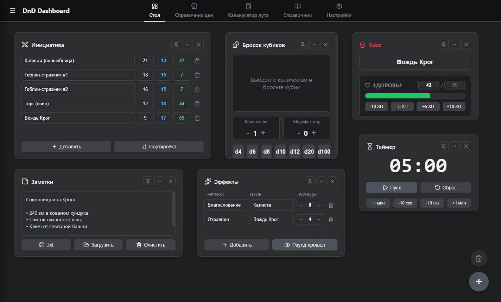
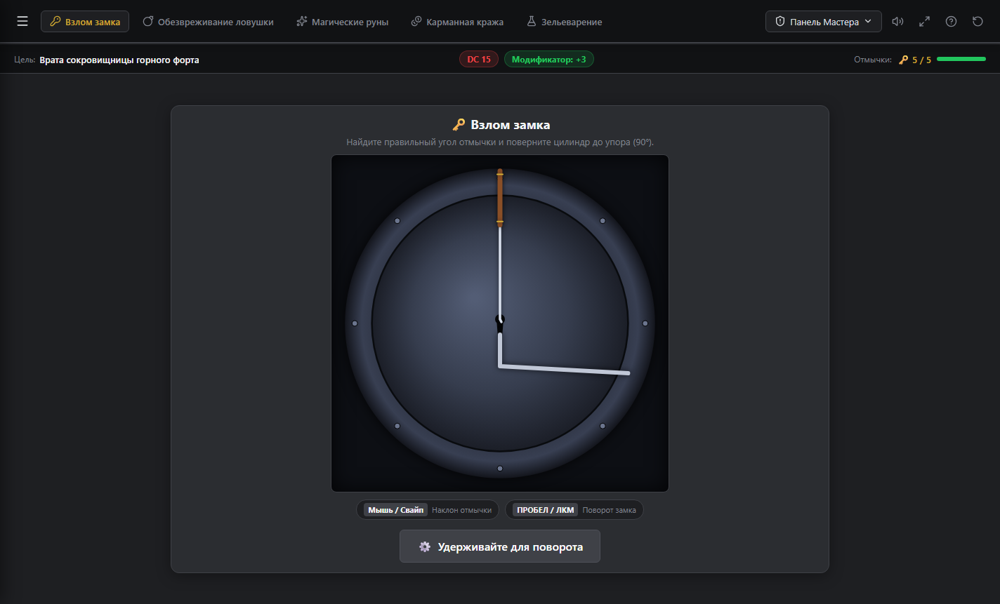
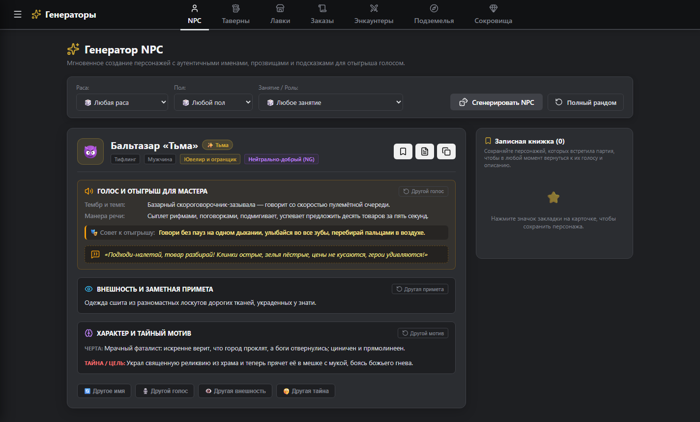
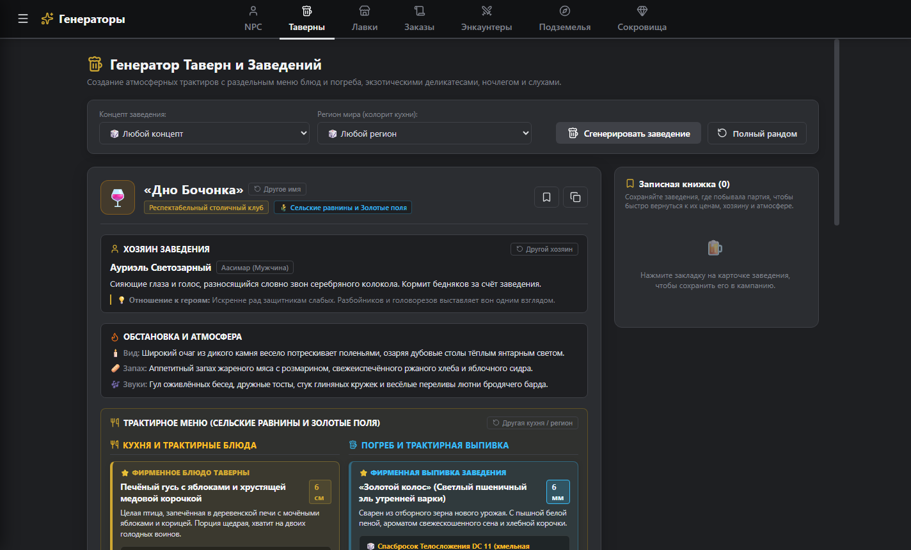
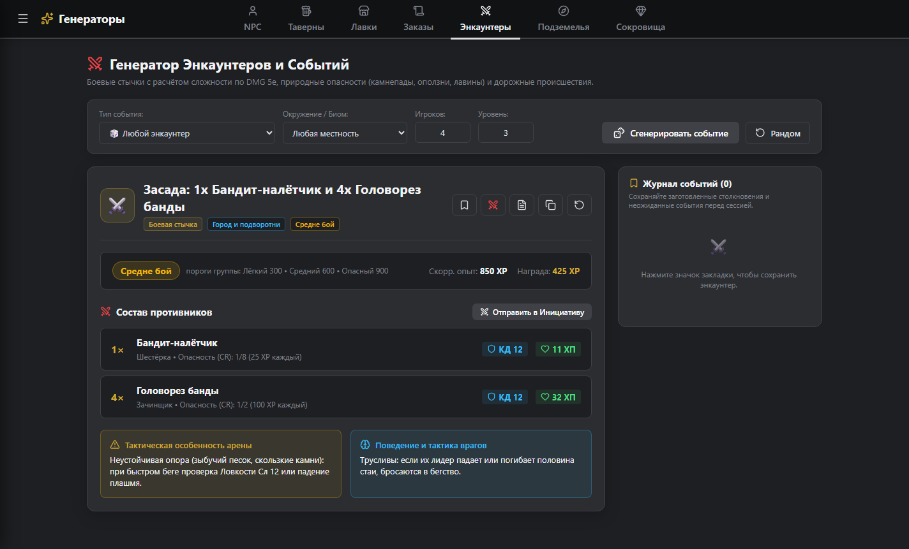
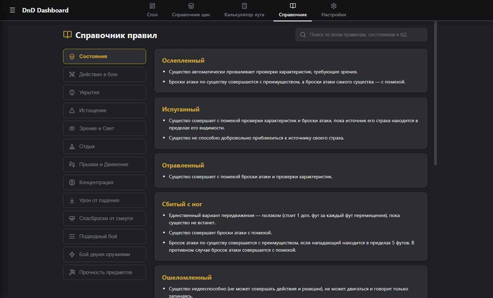

> **[ 🇬🇧 Read in English ](README.md) | [ 🇷🇺 На русском ](README.ru.md)**

# ⚜️ DnD Dashboard — Master Suite

**All-in-one desktop companion for D&D 5e Dungeon Masters:** interactive DM Table, physical Trials Workshop with procedural audio, content generators, and SRD 5e references — all in a sleek, modern desktop app.

[](https://www.electronjs.org/)
[](https://react.dev/)
[](https://vite.dev/)
[](https://www.dndbeyond.com/)
[](LICENSE)

---

## ✨ Features

### 🎲 DM Table
A modular workspace where each tool is a draggable, resizable card with persistent state and layout:
- **Initiative Tracker** — tracks initiative order, AC, current/max HP, and conditions.
- **Dice Roller** — roll any formula (`5d8 + 4`, `2d20kh1`) with roll history.
- **Scratchpad (Notes)** — quick notes with autosave, JSON scene export & import.
- **Session Timer** — countdown timer with audio alert.
- **Effect Tracker** — track spell concentration and condition durations round by round.
- **Boss Tracker** — epic health bar, legendary resistances, and legendary actions.

### ⚔️ Trials Workshop (Interactive Skill Checks)
Five physical mini-games for roleplaying skill checks instead of flat d20 rolls, powered by **procedural Web Audio API sound synthesis**:

| Trial | Mechanic |
| --- | --- |
| 🗝️ **Lockpicking** | Skyrim-inspired lock kinematics: pick angle, tension wrench control, pick breakage |
| 🎒 **Pickpocketing** | Target vigilance, living NPC eye tracking, belt tension & grab timing |
| 💣 **Trap Disarming** | 4 mechanisms: tripwire, clockwork gearwork, balance scale plate, poison gas manometer |
| 🔮 **Arcane Runes** | Concentric puzzle rings, conduit alignment, elemental flow balancing |
| 🧪 **Alchemy & Brewing** | Canonical D&D 5e potion recipes, crucible heat control, reagent balance |

**DM Curtain:** Set custom DC, character bonuses, roll behind the screen, or hand off control to players.

### 📜 Procedural Content Generators
- **NPC Generator** — 18 races, 49 professions, 24 voice-acting profiles with speech mannerisms, secrets, and session bookmarking.
- **Taverns & Inns** — ambience, local rumors, food & drink menus with Constitution saving throws, lodging tiers.
- **Shops & Merchants** — district wealth scaling, showcase items, secret counter lots, security checks.
- **Quests & Bounties** — hooks, objectives, twists, and rewards.
- **Encounters** — combat, social, travel hazards, and weather events by biome.
- **Dungeon Rooms** — architecture, sensory details, hazards, and room dressing.
- **Loot & Treasures** — scaled by encounter CR, art objects, gems, and coins.

**One-Click Table Integration:** Send monsters directly to the Initiative Tracker and notes/loot straight to the Scratchpad via toast notifications.

### 📖 References & Calculators
- **D&D 5e Rules Reference** — live search across conditions, combat actions, cover, exhaustion, rest, and concentration.
- **Price Handbook** — canonical prices for adventuring gear, weapons, armor, mounts, and services.
- **Loot Calculator** — party loot splitting and coin weight conversion.

---

## 🖼️ Screenshots

| DM Table | Trials Workshop |
| :---: | :---: |
|  |  |

| NPC Generator | Tavern & Inn Generator |
| :---: | :---: |
|  |  |

| Encounter Generator | Rules & Reference Guide |
| :---: | :---: |
|  |  |

---

## 🎨 Design System
- **Modern Dark Theme:** Deep slate `#1e1f22`, card surfaces `#2b2d31`, clean typography.
- **Frameless Dark Titlebar:** native Windows controls overlay integrated directly into the top navigation.
- **Bilingual Interface:** Automatic system language detection (`ru` for Russian OS, `en` for all other languages) with instant manual switching in Settings.

---

## 🧱 Tech Stack

- **Electron 42** — Cross-platform desktop shell.
- **React 19** — Reactive UI and modular state management.
- **Vite 7 + electron-vite 5** — Fast bundling and hot module replacement.
- **React Router 7** — Fluid tab-based navigation.
- **react-rnd** — Free-form draggable and resizable DM Table cards.
- **lucide-react** — Minimalist fantasy & tabletop iconography.
- **Web Audio API** — Real-time procedural audio synthesis for all skill trials (zero static audio files).
- **Pure CSS3** — Handcrafted modern dark design system without bulky external UI frameworks.

---

## 🚀 Getting Started

### Prerequisites
- [Node.js](https://nodejs.org/) (version 18 or higher)
- npm / yarn

### Installation & Development
```bash
# 1. Clone repository
git clone https://github.com/KweNy3223/dnd_dashboard.git
cd dnd_dashboard

# 2. Install dependencies
npm install

# 3. Start development server with live preview
npm start

# 4. Build web bundle
npm run build

# 5. Build Windows installer (.exe)
npm run build:win
```

---

## 📦 Releases & Downloads
Prebuilt Windows `.exe` installers are available under the [Releases](https://github.com/KweNy3223/dnd_dashboard/releases) tab. No Node.js or installation steps required!

---

## 📄 License
This project is licensed under the [MIT License](LICENSE).
