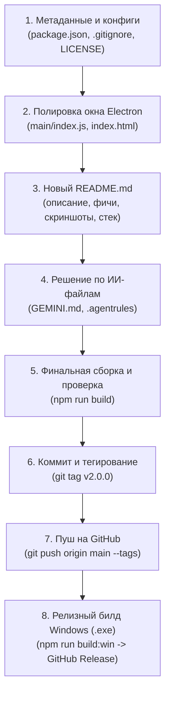

# 📋 План подготовки и публикации обновления DnD Dashboard на GitHub (v2.0.0)

> **Статус проекта на текущий момент:**  
> Локальная ветка `main` опережает `origin/main` на **57 коммитов**, затронуто **37 файлов**, добавлено **+24 861 строка кода**.  
> Сборка проекта (`npm run build`) проверена — завершается успешно (код 0) без ошибок.

---

## 🎯 Цели релиза
1. Привести репозиторий в профессиональный, аккуратный и презентабельный вид перед сообществом на GitHub.
2. Актуализировать документацию (`README.md`), отразив колоссальный объем добавленного функционала (Мастерская Испытаний, Генераторы, связка со Столом, Справочники).
3. Исправить мелкие шероховатости в Electron/HTML и метаданных `package.json`.
4. Опубликовать релиз с тегом `v2.0.0` и подготовить установщик `.exe` для пользователей.

---

## 🗺️ Дорожная карта выполнения (Чек-лист)



---

## 📝 Детальные шаги реализации

### Шаг 1. Актуализация `package.json`
* [ ] **Версия:** Поднять с `1.0.0` до `2.0.0` (мажорный скачок с масштабным обновлением функционала).
* [ ] **Метаданные:** Добавить недостающие поля:
  * `"description"`: `"All-in-one desktop assistant for D&D 5e Dungeon Masters featuring interactive trials, procedural generators, audio synthesis, and DM table tools"`
  * `"author"`: `"KweNy"`
  * `"license"`: `"MIT"`
  * `"repository"`: `{"type": "git", "url": "https://github.com/KweNy3223/dnd_dashboard.git"}`
  * `"keywords"`: `["dnd", "dnd5e", "dungeon-master", "electron", "react", "tabletop", "minigames", "procedural-audio"]`

---

### Шаг 2. Оформление лицензии (`LICENSE`)
* [ ] Создать стандартный файл лицензии `LICENSE` (MIT License) на имя `KweNy` (2026), чтобы проект имел четкий Open Source статус.

---

### Шаг 3. Чистота `.gitignore`
* [ ] Добавить в [.gitignore](file:///Z:/dnd_dashboard/.gitignore) правила исключений для редакторов и системных логов:
  ```gitignore
  .vscode/
  .idea/
  *.log
  npm-debug.log*
  yarn-debug.log*
  release/
  ```

---

### Шаг 4. Устранение шероховатостей Electron и HTML
* [ ] **[src/main/index.js](file:///Z:/dnd_dashboard/src/main/index.js):**
  * Добавить `backgroundColor: '#1e1f22'` в свойства `BrowserWindow` — это полностью предотвратит белую вспышку при холодном запуске окна до загрузки стилей темы.
  * Добавить явный заголовок окна: `title: 'DnD Dashboard — Master Suite'`.
* [ ] **[src/renderer/index.html](file:///Z:/dnd_dashboard/src/renderer/index.html):**
  * Обернуть файл в валидный стандарт HTML5 (`<!DOCTYPE html>`, `<html lang="ru">`, `<head>`, `<meta charset="UTF-8">`, `<title>`, `<meta name="viewport">`).
  * Убрать строку с принудительным `window.process = { env: { NODE_ENV: 'development' } }`, чтобы React в собранном приложении работал в оптимизированном продакшн-режиме.

---

### Шаг 5. Полная перезагрузка `README.md`
* [ ] **Заголовок и бейджи:** Красивая шапка (Electron, React 19, Vite, D&D 5e, MIT License).
* [ ] **Ключевые возможности:**
  1. **Стол Мастера (Master Table):** Трекер инициативы (КД, ХП, состояния), кубики с историей, Scratchpad с автосохранением и JSON-экспортом/импортом, таймер, эффекты, трекер босса.
  2. **Мастерская Испытаний (Trials Workshop):** 5 мини-игры с процедурным звуком Web Audio API:
     * 🗝️ Взлом замков (Skyrim-механика, отмычка и шпилька, натяжение);
     * 🎒 Карманная кража (живой поворот взгляда NPC, натяжение пояса);
     * 💣 Обезвреживание ловушек (растяжка, весы нажимной плиты, поворотный шплинт, ядовитый газ с манометром);
     * 🔮 Рунные цепи (концентрические кольца и потоки стихий);
     * 🧪 Алхимия (каноничные рецепты D&D 5e, огонь, балансировка трав).
     * 🎛️ Панель ДМа (настройка СЛ/DC, броски втайне от игроков, ручной ввод).
  3. **Генераторы контента (Generators):**
     * Генератор NPC (18 рас, 49 профессий, 24 характера голоса с советами по отыгрышу, секреты).
     * Таверны и трактиры (атмосфера, слухи, меню еды и напитков с эффектами спасбросков телосложения, постояльцы).
     * Лавки и торговцы (районы, витрина, секретный лот под прилавком, охрана).
     * Квесты, Энкаунтеры (боевые, социальные, природные), Комнаты подземелья, Сокровища и лут.
  4. **Интеграция со Столом:** Мгновенный перенос монстров из энкаунтеров в Инициативу и заметок генератора прямо в Scratchpad через всплывающие тосты.
  5. **Справочники:** Интерактивный поиск правил 5e на лету + справочник цен на предметы.
  6. **Discord-style интерфейс:** Сайдбар, темная тема `#1e1f22`, горячие клавиши.
* [ ] **Инструкция по установке и запуску:**
  ```bash
  git clone https://github.com/KweNy3223/dnd_dashboard.git
  cd dnd_dashboard
  npm install
  npm start         # Режим разработки
  npm run build     # Сборка веб-части
  npm run build:win # Сборка установщика для Windows (.exe)
  ```

---

### Шаг 6. Вопрос по файлам конфигурации ИИ (`GEMINI.md`, `.agentrules`)
> [!NOTE]
> В текущей истории коммитов отслеживаются файлы `GEMINI.md` и `.agentrules`, где зафиксированы инструкции нашего тандема (Артём & Гравити).
> 
> **Варианты на выбор:**
> 1. **Оставить как есть:** Открыто показывать, что проект создается в тандеме разработчика и ИИ-напарника.
> 2. **Скрыть из Git (Рекомендуется для публичных релизов):** Удалить их из индекса Git (`git rm --cached GEMINI.md .agentrules`) и добавить в `.gitignore`, чтобы они оставались локально у тебя на компьютере, но не попадали на GitHub.

---

### Шаг 7. Проверка сборки и публикация
* [ ] Выполнить контрольную сборку: `npm run build`.
* [ ] Закоммитить подготовленные изменения:
  ```bash
  git add .
  git commit -m "chore(release): prepare project for v2.0.0 release (docs, metadata, clean index, discord theme polish)"
  ```
* [ ] Создать тег версии:
  ```bash
  git tag -a v2.0.0 -m "Release v2.0.0 - D&D Master Suite with Trials Workshop and Generators"
  ```
* [ ] Отправить всё на GitHub:
  ```bash
  git push origin main
  git push origin --tags
  ```

---

### Шаг 8. Публикация готового .exe (Опционально, но очень полезно)
* [ ] Запустить сборку инсталлятора: `npm run build:win`.
* [ ] В папке `dist/` появится файл вида `DnD Dashboard Setup 2.0.0.exe`.
* [ ] На GitHub в разделе **Releases** создать новый релиз на основе тега `v2.0.0` и прикрепить этот `.exe` файл, чтобы любой желающий мог скачать и запустить приложение без Node.js.
